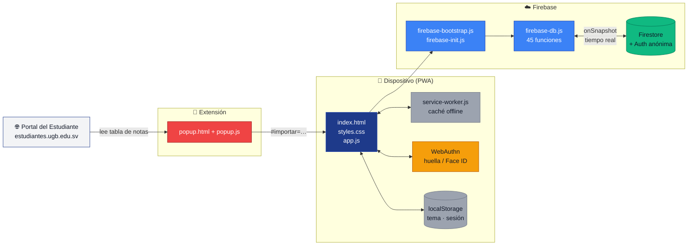
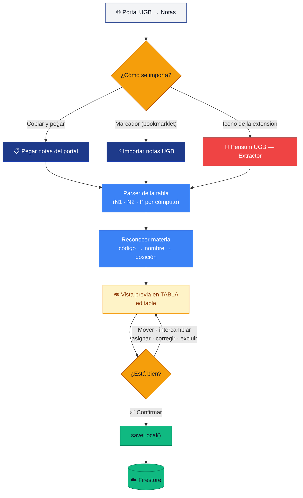
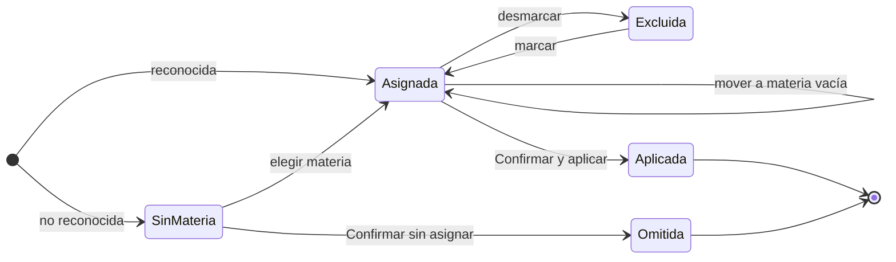
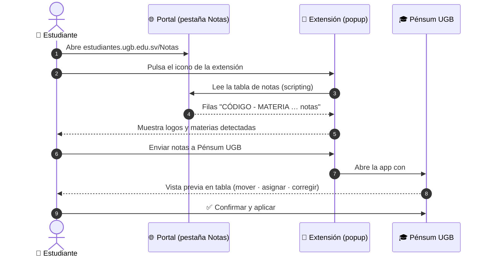
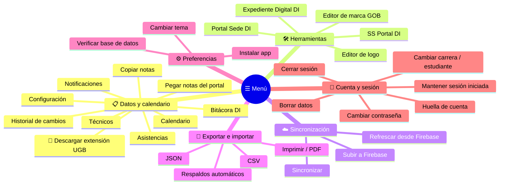
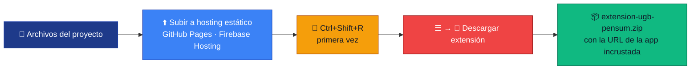

<div align="center">

&nbsp;&nbsp;&nbsp;&nbsp;

# 🎓 Pénsum UGB

**Seguimiento académico · Asistencia · Bitácora DI**<br>
Universidad Gerardo Barrios · Dirección de Integración


</div>

<p align="justify">
Sistema de seguimiento académico (pénsum, notas, calendario, asistencia y bitácora DI) para estudiantes de la
Universidad Gerardo Barrios. Funciona <b>100 % conectado a Firebase</b>, sin backend propio, sin Google Apps Script
y sin polling. Es una PWA instalable, con inicio de sesión por huella o Face ID, una <b>vista previa en tabla editable</b>
para importar notas del portal y una <b>extensión de Chrome/Edge</b> que extrae las notas directamente del
Portal del Estudiante.
</p>

---

## 📑 Índice

<div align="center">

| # | Sección | # | Sección |
|:-:|:--|:-:|:--|
| 1 | [Arquitectura](#-arquitectura) | 6 | [Catálogo de funciones](#-catálogo-de-funciones-por-módulo) |
| 2 | [Estructura de archivos](#-estructura-de-archivos) | 7 | [Instructivo de uso](#-instructivo-de-uso) |
| 3 | [Paleta de colores](#-paleta-de-colores) | 8 | [Despliegue](#-instructivo-de-despliegue) |
| 4 | [Importar notas del portal](#-importar-notas-del-portal) | 9 | [Reglas de Firestore](#-reglas-de-seguridad-de-firestore) |
| 5 | [Menú ☰](#-menú--estructura) | 10 | [Cosas importantes](#-cosas-importantes) |

</div>

---

## 🏗️ Arquitectura

<p align="justify">
Cada dispositivo (celular, laptop, kiosko) carga el mismo cascarón PWA (<code>index.html</code> + <code>styles.css</code> +
<code>app.js</code>) y habla <b>directo</b> con Firebase. En cuanto un dispositivo guarda algo, los demás lo reciben solos
mediante <code>onSnapshot</code>, sin recargar. WebAuthn vive enteramente en el dispositivo: la credencial nunca sale de ahí.
Las fotos de firmas y sellos se guardan comprimidas en base64 dentro del propio documento, sin Cloud Storage.
</p>



---

## 🗂️ Estructura de archivos

<div align="center">

| Archivo | Rol |
|:--|:--|
| `index.html` | Markup de la app: vistas, modales, menú. Sin CSS ni JS incrustado. |
| `styles.css` | Todo el CSS (tema claro/oscuro, layout, componentes, tabla de vista previa). |
| `app.js` | html2canvas + jsPDF (locales) y toda la lógica de la app. |
| `calculos.js` · `calculos.test.js` | Funciones de cálculo puro (`calcComputo`, `calcFinal`, `escapeHtml`, `_fmtNota`…) y sus pruebas con Node. |
| `firebase-bootstrap.js` | `<script type="module">` que conecta `firebase-init.js` + `firebase-db.js` a `window.FirebaseDB`. |
| `firebase-init.js` | Conexión a Firebase (Firestore + Auth anónima). |
| `firebase-db.js` | 45 funciones de lectura / escritura / escucha en Firestore. |
| `extension-ugb.js` | **Nuevo.** Arma en el navegador el `.zip` de la extensión (ZIP sin compresión, sin librerías). |
| `extension-ugb/` | **Nuevo.** Código fuente de la extensión: `manifest.json`, `popup.html`, `popup.js`, `LEEME.txt`. |
| `service-worker.js` | Cachea el cascarón para uso offline (`pensum-ugb-v8`). Nunca cachea datos de Firebase. |
| `manifest.json` | Metadatos de instalación PWA. |
| `horarios.html` | Visor de horario standalone, sin dependencias de Firebase. |
| `editordelogo.html` | Editor de logo independiente. |
| `Logotipo-horizontal-azul.png` · `logo2.jpg` · `DI.svg` · `icon-*.png` | Logos UGB y Dirección de Integración, e íconos PWA. La extensión los reutiliza. |

</div>

---

## 🎨 Paleta de colores

<p align="justify">
Tipografía <a href="https://fonts.google.com/specimen/Inter">Inter</a> (300–800). El tema se guarda en
<code>localStorage['ugb_theme']</code> (<code>light</code> / <code>dark</code>), se aplica con <code>data-theme</code> en
<code>&lt;html&gt;</code> y se cambia con <b>☰ → Cambiar tema</b>. Los cuatro colores de estado son los mismos en ambos temas;
solo cambia su fondo y opacidad para verse bien en oscuro.
</p>

<div align="center">

| Muestra | Token | Hex | Uso |
|:-:|:-:|:-:|:--|
|  | `--blue-dk` / `--hdr` | `#1e3a8a` | Encabezado, botones primarios |
|  | `--blue` | `#1e40af` | Acento principal |
|  | `--blue-lt` | `#3b82f6` | Acento claro |
|  | `--pass` | `#10b981` | ✅ Aprobada |
|  | `--fail` | `#ef4444` | ❌ Reprobada / error |
|  | `--pend` | `#f59e0b` | ⏳ En curso / valores que cambian |
|  | `--none` | `#9ca3af` | Sin datos |
|  | `--bg` (claro) | `#f3f4f6` | Fondo claro |
|  | `--bg` (oscuro) | `#0f172a` | Fondo oscuro |
|  | `--card` (oscuro) | `#1e293b` | Tarjetas en oscuro |

</div>

---

## 📥 Importar notas del portal

<p align="justify">
Hay <b>tres caminos</b> para traer las notas del Portal del Estudiante, y los tres terminan en la misma
<b>vista previa en tabla</b>: nada se guarda hasta pulsar <b>✅ Confirmar y aplicar</b>.
El reconocimiento de materias no depende solo del código: si el código no calza con el nombre (por ejemplo
<i>Educación Ciudadana</i>, 1180 en el pénsum y 1186 en el portal) se busca por <b>nombre</b> ignorando tildes y mayúsculas.
</p>



### 👁️ Vista previa en tabla editable

<p align="justify">
Cada fila del portal es independiente de la materia a la que se asigna. Así se puede corregir un reconocimiento
equivocado antes de sobrescribir nada. Los valores que cambian respecto a lo ya cargado se marcan en
<b>amarillo</b>; las filas sin materia, en <b>rojo</b> y arriba.
</p>

<div align="center">

| Acción | Cómo se hace | Resultado |
|:--|:--|:--|
| **Asignar materia** | Selector de la fila | Si la materia ya está ocupada, **las dos filas se intercambian** |
| **Intercambiar** | Arrastrar ☰ sobre otra fila · o ⇄ en una fila y luego ⇄ en la otra | Las filas cambian de materia |
| **Mover** | Arrastrar ☰ a una materia punteada · o ⇄ → «Mover aquí» | La fila pasa a una materia sin notas |
| **Corregir** | Editar la celda N1 / N2 / P | La celda se marca si difiere de lo cargado |
| **Excluir** | Desmarcar el checkbox de la fila | Esa fila no se aplica |

</div>



### 🧩 Extensión de Chrome / Edge

<p align="justify">
Desde <b>☰ → 🧩 Descargar extensión UGB</b> la app genera <code>extension-ugb-pensum.zip</code> con los logos de la UGB y de la
Dirección de Integración y con <b>la dirección de esta app ya incrustada</b>. No hay que subir el zip al repositorio: se arma al vuelo
a partir de la carpeta <code>extension-ugb/</code>. La extensión solo actúa sobre <code>estudiantes.ugb.edu.sv</code>, cuando el
usuario pulsa su icono, y no envía datos a ningún servidor.
</p>



<div align="center">

| Paso | Instalación (Chrome · Edge · Brave) |
|:-:|:--|
| 1 | Descomprimir el `.zip` en una carpeta (no borrarla después) |
| 2 | Abrir `chrome://extensions` (en Edge: `edge://extensions`) |
| 3 | Activar **Modo de desarrollador** |
| 4 | **Cargar descomprimida** y elegir la carpeta |
| 5 | Fijar el icono desde la pieza de rompecabezas, si no se ve |

</div>

---

## ☰ Menú — estructura

<p align="justify">
El menú es un panel lateral (drawer) con el logo de la universidad arriba, cuerpo con scroll y pie de página.
El orden real en la app es una sola lista continua; aquí se agrupa por tema.
</p>



---

## 📚 Catálogo de funciones por módulo

<p align="justify">
Referencia de las funciones de <code>app.js</code> y <code>firebase-db.js</code>. Las que empiezan con <code>_</code> son auxiliares
internas (no se llaman directo desde el HTML). Cada módulo está plegado: pulsa el título para abrirlo.
</p>

<details>
<summary><b>🔐 Cuentas y acceso</b> — login, huella/WebAuthn, contraseña, administración de cuenta</summary>

<div align="center">

| Función | Qué hace |
|:---|:---|
| `init()` | Arranque de la app: tema, zoom, muestra selección de carrera. |
| `chooseCareer(career)` | Carga estudiantes de esa carrera desde Firestore y muestra el login. Dispara el auto-inicio con huella al final. |
| `backToCareerSelect()` | Vuelve a la pantalla de selección de carrera. |
| `setLoginMode(m)` / `renderStudentList()` | Login por lista de cuentas o por nombre+contraseña directo. |
| `loginFromList(name)` / `doLogin()` / `selectStudent(name)` | Flujos de inicio de sesión. |
| `_checkPassword()` / `_saveHash()` | Verifica/guarda el hash SHA-256 de nombre+contraseña. |
| `openChangePass()` / `doChangePass()` / `togglePassVis()` | Modal de cambio de contraseña. |
| `_huellaSoportada()` | ¿El navegador soporta WebAuthn (HTTPS + API disponible)? |
| `_huellaDisponibleEnEsteDispositivo()` | ¿Este dispositivo tiene lector de huella/Face ID configurado? |
| `_actualizarBotonHuella()` | Muestra/oculta el botón de huella en el login según soporte. |
| `agregarHuellaDispositivo()` | Registra una huella nueva para la cuenta activa, atada a este dispositivo. |
| `loginConHuella(opts)` | Inicia sesión con una huella ya registrada. `opts.silencioso` lo usa el auto-inicio (sin toasts de error). |
| `_huellaAutoInicioActivo()` / `_setHuellaAutoInicio(on)` | Lee/guarda en `localStorage` si el auto-inicio está activado en este dispositivo. |
| `_intentarAutoInicioHuella()` | Se llama al mostrar el login: si el auto-inicio está activo y hay lector disponible, intenta la huella sola. |
| `openHuellaModal()` / `_renderHuellasList()` / `eliminarHuellaUI(credId)` | Modal "Huella de cuenta": ver/quitar huellas de la cuenta activa. |
| `abrirHuellasGenerales()` | Panel de administrador (pide contraseña `747`) que lista las huellas de **todas** las cuentas. |
| `_huellaEtiquetaDispositivo()` | Arma la etiqueta legible ("Windows · Edge · 05 ago 2026") para cada huella. |
| `_sha256()` / `_sha256Bytes()` / `_buf2b64url()` / `_bytes2hex()` | Utilidades criptográficas (hash de contraseña e identificadores WebAuthn). |
| `openDeleteDataModal()` / `ejecutarBorrado()` | Borra los datos de la cuenta activa (pide contraseña admin). |
| `resetearBaseDeDatosUI()` | Reinicia toda la base de datos de Firestore (pide contraseña admin). |
| `toggleAccountListVisibility()` / `applyAccountListVisibility()` | Muestra/oculta la lista de cuentas en el login (config. global protegida). |
| `changeStudent()` / `cerrarSesion()` / `deleteStudent(name)` | Cambiar de cuenta / cerrar sesión / eliminar una cuenta. |
| `openAdvanced()` / `abrirModoAvanzado()` | Panel avanzado: verificar/inicializar la base de datos. |
| `limpiarCache()` / `recargarLista()` | Limpia caché del service worker y recarga. |
| `getStudentData()` / `getSubjectData(num)` | Devuelve los datos en memoria de la cuenta/materia activa. |
| `_guardarUserConfig()` | Persiste preferencias del usuario (técnico/firma por defecto) en `localStorage`. |
| `_jsonpFetch()` / `_apsFetch()` | Restos del sistema anterior (Apps Script) — ya no se usan con Firebase. |

</div>

**Firebase (`firebase-db.js`):** `studentId` · `sha256` · `listarEstudiantes` · `crearOCargarEstudiante` · `verificarPassword` · `guardarPasswordHash` · `eliminarEstudiante` · `registrarHuellaIndice` · `resolverHuellaIndice` · `listarHuellas` · `agregarHuella` · `eliminarHuella` · `listarTodasLasHuellas` · `getShowAccountList` · `setShowAccountList` · `initFirestoreDatabase` · `resetearBaseDeDatos`
</details>

<details>
<summary><b>🎓 Pénsum</b> — ciclos, materias, notas, deshacer/rehacer</summary>

<div align="center">

| Función | Qué hace |
|:---|:---|
| `renderPensum()` / `showPensum()` | Dibuja la malla curricular completa. |
| `openCycle(id)` / `renderSubjects(cycle)` | Abre un ciclo y dibuja sus materias. |
| `toggleSubject(num)` / `saveSubject(num)` | Expande una materia / guarda sus cambios. |
| `updateGrade(num,ci,field,val)` / `buildComputos()` | Actualiza una nota de un cómputo y recalcula. |
| `calcComputo(c)` / `calcFinal(computos)` | Calcula el promedio de un cómputo / la nota final. |
| `getStatus()` / `getEffectiveGrade()` / `getEffectiveStatus()` | Determina si una materia está aprobada/reprobada/en curso. |
| `swapSubjects()` / `moveSubjectToCycle()` | Intercambia o mueve una materia entre ciclos (electivas). |
| `toggleSpecialCard(num)` / `fillWithSix()` | Marca una materia como especial / autocompleta notas. |
| `toggleCycleDone()` / `updateCycleDoneBtn()` | Marca un ciclo completo como finalizado. |
| `updateStats()` | Recalcula contadores (aprobadas, pendientes, promedio). |
| `undoPensum()` / `redoPensum()` / `updateUndoRedoBtns()` / `snapshotCycles()` | Deshacer/rehacer cambios en el pénsum. |
| `openHistPensum()` / `setHistFilter()` / `renderHistPensum()` / `restoreSnapshot(idx)` | Historial completo de cambios, con restauración a un punto anterior. |
| `askDelete()` / `confirmDelete()` / `closeDeleteModal()` / `clearComputo()` / `clearCurrentCycle()` | Borrado de notas/cómputos/ciclo. |
| `findSubject(num)` / `filterByPeriod()` | Búsqueda de materia por número / filtro por período. |
| `updateZoom(val)` / `toggleEditMode()` | Zoom de la malla / modo edición. |

</div>

<p align="justify">

**Firebase:** `guardarCiclosDone` · `guardarEspeciales` · `guardarPensumCycles` · `guardarPensumHistorial` · `escucharPensumHistorial`

</p>
</details>

<details>
<summary><b>📋 Notas del portal</b> — pegar, vista previa en tabla, copiar y extensión</summary>

<div align="center">

| Función | Qué hace |
|:---|:---|
| `openPasteModal()` / `closePasteModal()` / `processPaste()` | Pega el texto copiado del portal UGB y lo interpreta en notas. |
| `pegarDesdePortapapeles()` | Lee el portapapeles y procesa directo. |
| `_parsearTablaPortal(text)` | Convierte el texto en filas `{codigo, nombre, nums}` (usa los últimos 14 números de cada línea). |
| `_buscarMateriaPortal()` / `_similitud()` / `_normTexto()` | Reconocen la materia por código y, si no calza, por nombre (ignora tildes y mayúsculas). |
| `_procesarTextoNotas(text, volverA)` | Arma las filas, marca las no reconocidas o duplicadas y abre la vista previa. |
| `_pvCargar()` / `_renderPastePreview()` / `_pvResumen()` | **Vista previa en tabla editable**: carga, dibuja y resume (cuántas filas cambian, cuántas sin materia). |
| `_pvAsignar(id, subNum)` | Cambia la materia de una fila; si está ocupada, intercambia con la otra fila. |
| `_pvSwap(a, b)` / `_pvTocar(id)` / `_pvMoverA(subNum)` | Intercambiar dos filas / modo táctil ⇄ / mover a una materia sin notas. |
| `_pvDragStart()` / `_pvDrop()` | Arrastrar y soltar (escritorio). |
| `_pvEditar()` / `_pvIncluir()` | Corregir una nota a mano / incluir o excluir una fila. |
| `confirmarPegadoNotas()` / `cancelarPegadoNotas()` | Aplica solo las filas incluidas y con materia / vuelve a editar. |
| `_codigoBookmarkletPortal()` / `prepararBookmarkletPortal()` / `_capturarImportacionDeURL()` / `_revisarImportacionPendiente()` | Importación por marcador o extensión mediante `#importar=…`. |
| `descargarExtensionUGB()` / `_zipStore()` / `_crc32()` | *(en `extension-ugb.js`)* Arma y descarga el `.zip` de la extensión. |
| `openCopyGradesModal()` / `closeCopyGradesModal()` | Modal para copiar notas hacia afuera. |
| `buildGradesPasteText(cycle)` / `renderCopyGradesText()` / `copyGradesToClipboard()` | Arma el texto de un ciclo y lo copia al portapapeles. |

</div>

<p align="justify">

**Firebase:** `guardarNotas` · `escucharNotas`

</p>
</details>

<details>
<summary><b>📅 Calendario</b> — eventos y su vínculo con el pénsum</summary>

<div align="center">

| Función | Qué hace |
|:---|:---|
| `openCalendarModal()` / `closeCalendarModal()` / `setCalFilter()` | Modal de calendario y sus filtros. |
| `addEvent(type)` / `saveEvent()` / `deleteEvent(id)` / `askDeleteEvent(id)` | Crear/guardar/eliminar un evento. |
| `eventTypeNeedsComputo()` / `eventTypeToField()` / `updateEventSubjects()` | Relacionan el tipo de evento con una materia/cómputo del pénsum. |
| `toggleEventDone(id, checked)` / `setEventNota(id, val)` | Marcar evento como hecho / asignarle nota. |
| `syncEventNotaToPensum(ev)` | Refleja la nota del evento directo en la materia correspondiente del pénsum. |
| `renderEvents()` | Dibuja la lista de eventos filtrada. |

</div>

<p align="justify">

**Firebase:** `guardarEventos` · `escucharEventos`

</p>
</details>

<details>
<summary><b>🔔 Notificaciones</b> — avisos de vencimientos</summary>

<div align="center">

| Función | Qué hace |
|:---|:---|
| `computeNotifications()` / `computeAttendanceNotifItem()` | Calcula qué avisos corresponden mostrar ahora. |
| `daysUntil()` / `notifTier()` / `notifDaysLabel()` / `notifTierColor()` / `notifTierIcon()` | Traducen días restantes a nivel de urgencia (color/ícono/texto). |
| `refreshNotifBadge()` / `openNotifModal()` / `closeNotifModal()` / `renderNotifList()` | Badge del menú y modal con la lista de avisos. |
| `dismissAttendanceNotif()` / `dismissNotifItem()` | Descartar un aviso puntual. |
| `openNotifConfig()` / `closeNotifConfig()` / `saveNotifConfigUI()` / `resetNotifConfig()` / `loadNotifConfig()` / `saveNotifConfig()` | Configuración de anticipación y duración de avisos. |
| `showNotifToast()` / `dismissNotifToast()` / `_attachNotifSwipe()` / `checkAndShowNotifToasts()` | Notificaciones emergentes (toast) con gesto de swipe para cerrar. |
| `startNotifWatcher()` / `stopNotifWatcher()` | Revisión periódica de nuevos avisos mientras la app está abierta. |
| `getNotifSeen()` / `setNotifSeen()` / `getNotifDismissed()` / `setNotifDismissed()` / `notifConfigStorageKey()` / `notifSeenStorageKey()` / `notifDismissedStorageKey()` / `_notifKeyBase()` | Persistencia en `localStorage`, por cuenta y dispositivo. |

</div>
</details>

<details>
<summary><b>🏛 Asistencia diaria</b> — marcar con huella, filtrar, exportar</summary>

<div align="center">

| Función | Qué hace |
|:---|:---|
| `openAsistencia()` / `renderAsistencia()` / `setAsistFilter()` | Modal de asistencia diaria y sus filtros. |
| `marcarAsistencia()` / `getTodayKey()` / `getAsistencias()` / `_showAsistConfirm()` | Registra la asistencia del día (con confirmación visual). |
| `borrarAsistencia(fecha)` | Elimina un registro de asistencia. |
| `_asistenciaFilteredEntries()` / `_asistFilterLabel()` | Lógica de filtrado por fecha/rango. |
| `generateAsistenciaPDF()` / `_asistPdfHeader()` / `_asistPdfFooter()` / `_asistPdfSectionBanner()` / `_asistPdfTrunc()` / `_horaCorta()` / `_cuposCorto()` | Genera el PDF de asistencia con logos y encabezado institucional. |
| `exportAsistenciaExcel()` | Exporta a Excel. |

</div>

<p align="justify">

**Firebase:** `guardarAsistencia` · `guardarAsistencias` · `escucharAsistencias`

</p>
</details>

<details>
<summary><b>📝 Asistencia de actividad</b> — registro manual de actividades</summary>

<div align="center">

| Función | Qué hace |
|:---|:---|
| `openAsistenciaActividad()` / `renderAsistenciaActividad()` / `setActFilter()` | Modal y filtros de asistencia por actividad. |
| `validarAsistenciaActividad()` / `_toggleActOtro()` | Valida el formulario / campo "otro" libre. |
| `borrarAsistenciaActividad(id)` / `verDetalleActividad(id)` / `borrarAsistenciaActividadDesdeDetalle()` | Ver detalle / eliminar un registro. |
| `_actividadFilteredEntries()` / `_actFilterLabel()` | Filtrado por fecha/rango. |
| `generateActividadPDF()` / `_actividadPdfColumnas()` / `_actividadPdfDrawHead()` / `_actividadPdfDrawRow()` | Genera el PDF de asistencia de actividad. |
| `exportActividadExcel()` | Exporta a Excel. |

</div>

<p align="justify">

**Firebase:** `guardarAsistenciasActividad` · `escucharAsistenciasActividad`

</p>
</details>

<details>
<summary><b>🖨️ Exportación</b> — combinada, PDF del pénsum, CSV, JSON</summary>

<div align="center">

| Función | Qué hace |
|:---|:---|
| `abrirExportAsistencia()` / `_toggleExportAsistCombo()` / `confirmarExportAsistencia()` | Exportar asistencia diaria + de actividad juntas. |
| `generateAsistenciaCombinadaPDF()` / `exportAsistenciaCombinadaExcel()` | Genera ese PDF/Excel combinado. |
| `exportJSON()` / `importJSON()` / `exportCSV()` / `importCSV()` | Copia de seguridad completa de una cuenta. |
| `openPdfModal()` / `closePdfModal()` / `updatePdfModalUIState()` / `togglePdfCycleSelect()` / `togglePdfCustomList()` | Modal de exportación del pénsum a PDF, con varias opciones de contenido. |
| `generatePdfFromModal()` / `exportPDF()` / `exportPDFDirect()` | Arman el PDF final (dos motores: HTML→jsPDF y captura directa con html2canvas). |
| `buildPdfHeaderHTML()` · `buildPdfMiniHeaderHTML()` · `buildPdfYearRowHTML()` · `buildPdfSubjectCardHTML()` · `buildPdfElectiveRowHTML()` · `buildPdfElectivesSectionHTML()` · `buildPensumPageHTML()` · `buildPdfCycleDetailBlockHTML()` · `buildCyclePageHTML()` · `buildSummaryTableHTML()` · `buildReportHTML()` | Construyen cada bloque visual del PDF del pénsum. |
| `chunkArray()` / `pdfDirectMmToCssPx()` / `pdfDirectWaitImages()` / `pdfDirectRasterizeSvgLogos()` | Utilidades de maquetado/rasterizado para el PDF. |

</div>
</details>

<details>
<summary><b>☁️ Sincronización</b> — tiempo real + manual</summary>

<div align="center">

| Función | Qué hace |
|:---|:---|
| `saveLocal()` / `triggerAutoSync()` / `_enqueueSync()` / `_updateSyncBadge()` | Guardado local inmediato + cola de sincronización automática. |
| `startAutoSyncInterval()` / `stopAutoSyncInterval()` | Sincronización periódica en segundo plano. |
| `syncToFirebase()` / `fetchFromFirebase()` / `sincronizarTodo()` | Subir / bajar / sincronizar todo manualmente (botones del menú). |
| `_applyRemoteUpdate(d)` | Aplica un cambio recibido en tiempo real de otro dispositivo (`onSnapshot`). |

</div>

<p align="justify">

**Firebase:** `cargarEstudianteUnaVez` · `escucharEstudiante` *(listener combinado: perfil, notas, eventos, asistencias, historial)*

</p>
</details>

<details>
<summary><b>📍 Horario ("¿Dónde estoy?")</b></summary>

<div align="center">

| Función | Qué hace |
|:---|:---|
| `openDondeEstoy()` / `closeDondeEstoy()` / `refreshDondeEstoyUI()` / `_dondeEstoyUrl()` | Modal que abre `horarios.html` (mismo origen, sin bloqueo de cookies de terceros). |
| `onHorarioSynced()` / `_autoAbrirDondeDebo()` | Reacciona cuando el horario está listo / lo abre automáticamente si aplica. |
| `editarHorario()` / `guardarHorarioEnServidor()` | Edición del horario y guardado en Firestore. |

</div>

<p align="justify">

**Firebase:** `guardarHorario`

</p>
</details>

<details>
<summary><b>📄 Bitácora DI</b> — formulario, borradores, PDF, historial</summary>

<div align="center">

| Función | Qué hace |
|:---|:---|
| `openBitacoraDI()` | Abre el formulario de bitácora. |
| `_bitacCargarTecnicos()` / `_bitacTecnicoPorNombre()` / `_bitacRefrescarSelectsTecnico()` / `_bitacTecnicoOptionsHTML()` | Cargan y listan los técnicos disponibles en los `<select>` del formulario. |
| `_bitacCargarActividadesPregrabadas()` / `_bitacPregrabadaOptionsHTML()` / `_bitacRefrescarPregrabadasSelects()` | Autocompletado con actividades guardadas de antemano. |
| `_bitacSellosDisponibles()` / `_bitacSelloPorId()` / `_bitacSelloOptionsHTML()` / `_bitacSelloPrefGet()` / `_bitacSelloPrefSet()` | Selección del sello a usar, con preferencia recordada por técnico. |
| `_bitacTecRespChange()` / `_bitacTecFieldHTML()` / `_bitacTecOtroToggle()` / `_bitacTecActualNombre()` / `_bitacTecChange()` / `_bitacSourceChange()` / `_bitacSetTecSelect()` | Interacciones de cada fila del formulario (técnico responsable/actuante). |
| `_bitacRenderRows(group)` / `_bitacLeerFila()` / `_bitacLeerFilaCruda()` | Dibuja y lee las filas de actividades de la bitácora. |
| `_bitacRecolectarFormulario()` / `_bitacAplicarFormulario(datos)` | Junta todo el formulario en un objeto / lo vuelve a pintar (para borradores). |
| `bitacGuardarBorrador()` / `bitacCargarBorradorSeleccionado()` / `bitacBorrarBorradorSeleccionado()` / `bitacFinalizarBorrador()` / `_bitacGetBorradores()` / `_bitacRenderBorradorSelect()` / `_bitacRenderBorradorEstado()` | Sistema de borradores: guardar avance sin finalizar la bitácora. |
| `_bitacDrawHeader()` · `_bitacDrawWatermark()` · `_bitacDrawPerfilTable()` · `_bitacCellText()` · `_bitacDrawTable()` · `_bitacDrawFirmaBlock()` · `_bitacDrawFooter()` · `_bitacConstruirPDF()` | Dibujan cada sección del PDF final de la bitácora (con marca de agua, tabla, firma y sello). |
| `generarBitacoraDIPDF()` | Genera y descarga el PDF final. |
| `openHistorialBitacoras()` / `_renderHistorialBitacoras()` / `_bitacHistBuscar(id)` | Historial de bitácoras ya generadas/archivadas. |
| `subirArchivoHistorial()` / `eliminarArchivoHistorial(id)` / `verBitacoraHist(id)` / `descargarBitacoraHist(id)` / `editarBitacoraHist(id)` | Subir un archivo escaneado, verlo, descargarlo, editarlo o eliminarlo del historial. |
| `_bitacArchivoLimiteBytes()` / `_bitacFileToDataUrlPlano()` / `_bitacComprimirImagenParaSubir()` / `_bitacDescargarDataUrl()` | Límite de tamaño, conversión y compresión de archivos antes de subirlos. |

</div>

<p align="justify">

**Firebase:** `guardarBitacoraPerfil` · `guardarBitacoraBorradores` · `guardarRegistroBitacora` · `listarBitacoras` · `eliminarRegistroBitacora`

</p>
</details>

<details>
<summary><b>🧑‍💼 Técnicos, firmas y sellos</b></summary>

<div align="center">

| Función | Qué hace |
|:---|:---|
| `openTecnicosModal()` / `_renderTecnicosList()` / `_tecNormalizarTexto()` | Modal con la lista de técnicos (búsqueda incluida). |
| `guardarTecnicoNuevo()` / `editarTecnico(id)` / `borrarTecnico(id)` / `_limpiarFormTecnico()` | Alta, edición y baja de técnicos. |
| `_tecEditarImg(input, kind)` / `_abrirImgEditor(dataUrl, kind)` / `_imgEditorAplicarTextos(kind)` | Abren el editor compartido de imagen al subir una firma o sello. |
| `_selloAplicarFiltros()` / `_selloEditorUsar()` | Brillo/contraste/fondo transparente del sello, y confirmación de uso. Incluye el atajo a **remove.bg** para quitar el fondo antes de editar. |
| `_bitacDataUrlToResizedB64()` / `_bitacFileToResizedB64()` | Redimensionan y comprimen la imagen antes de guardarla. |
| `_tecToggleQuitarBtn()` / `_tecQuitarImg(kind)` | Muestran/ejecutan el botón de quitar imagen ya cargada. |
| `abrirFirmaPad(target)` / `_bindFirmaPadEvents()` / `_firmaPadLimpiar()` / `_firmaPadUsar()` | Dibujar una firma a mano (mouse/dedo/lápiz óptico) como alternativa a subir una foto. |

</div>

<p align="justify">

**Firebase:** `listarTecnicos` · `guardarTecnico` · `eliminarTecnico`

</p>
</details>

<details>
<summary><b>⚙️ Configuración de usuario y actividades pregrabadas</b></summary>

<div align="center">

| Función | Qué hace |
|:---|:---|
| `openConfigUsuario()` / `guardarConfigUsuario()` | Modal de preferencias del dispositivo (técnico y sello/firma por defecto). |
| `_cfgTecnicoDefaultChange()` / `_cfgFirmaArchivo(input)` / `_cfgGuardarFirma(dataUrl)` | Cambiar el técnico por defecto / subir su firma (pasa por el editor de imagen + remove.bg). |
| `_renderActividadesPregrabadasList()` / `agregarActividadPregrabada()` / `eliminarActividadPregrabadaUI(id)` | Administra el catálogo de actividades pregrabadas (autocompletado en Bitácora). |

</div>

<p align="justify">

**Firebase:** `listarActividadesPregrabadas` · `guardarActividadPregrabada` · `eliminarActividadPregrabada`

</p>
</details>

<details>
<summary><b>🧭 Interfaz general y 📲 PWA</b></summary>

<div align="center">

| Función | Qué hace |
|:---|:---|
| `toggleTheme()` | Cambia entre tema claro/oscuro y lo recuerda en este dispositivo. |
| `toggleHam()` / `closeHam()` | Abre/cierra el menú lateral. |
| `showToast(msg, type)` | Mensaje emergente de confirmación/error, reutilizado en toda la app. |
| `_showLoading(msg, sub)` / `_hideLoading()` | Overlay de carga con mensaje. |
| `openAsistenciasHub()` | Modal selector entre Asistencia diaria / de actividad / Historial de bitácoras. |
| `escapeHtml(s)` | Sanitiza texto antes de insertarlo como HTML (evita inyección). |
| `_esIOS()` / `_appYaInstalada()` / `instalarApp()` | Detectan iOS/si ya está instalada, y disparan el prompt nativo de instalación PWA. |

</div>
</details>

---

## 📖 Instructivo de uso

<div align="center">

| Tarea | Pasos |
|:--|:--|
| **Primer ingreso** | 1. Elegir la carrera. 2. Elegir la cuenta de la lista (o escribir el nombre si está oculta: **☰ → 👁️ Mostrar/ocultar lista de cuentas**). 3. Si es la primera vez, se crea la cuenta con la contraseña escrita. |
| **Entrar con huella** | **☰ → 🫆 Huella de cuenta → «+ Agregar huella en este dispositivo»**. Para entrar solo, activar **«🚀 Auto-inicio con huella»** (por dispositivo). Si se cancela el diálogo, cae al usuario y contraseña. |
| **Importar notas** | **☰ → 📋 Pegar notas del portal** (pegar o portapapeles), o con la extensión 🧩. Revisar la **tabla de vista previa**, mover / intercambiar / asignar y **✅ Confirmar y aplicar**. |
| **Marcar asistencia** | **☰ → 📋 Asistencias → 🏛 Asistencia diaria → «Marcar asistencia de hoy»**. Exportar a PDF / Excel filtrando por fecha. |
| **Generar Bitácora DI** | **☰ → 📄 Bitácora DI**, elegir técnico responsable, llenar filas (con actividades pregrabadas), **Guardar borrador** cuando haga falta y **Generar PDF**. |
| **Firma o sello nítidos** | Al subir la foto se abre un editor (brillo, contraste, fondo transparente). Si hay sombras, usar **✂️ Abrir remove.bg** y volver a elegir el archivo resultante. |

</div>

---

## 🚀 Instructivo de despliegue

<p align="justify">
No se necesita servidor propio: se suben los archivos juntos a cualquier hosting estático (Firebase Hosting, GitHub Pages,
Netlify, Vercel). El botón de la extensión necesita que la app se abra <b>desde su dirección web</b> (no como archivo local)
y que la carpeta <code>extension-ugb/</code> esté junto a <code>index.html</code>.
</p>



<div align="center">

| Subir | Notas |
|:--|:--|
| `index.html` · `styles.css` · `app.js` · `calculos.js` | Núcleo de la app |
| `firebase-bootstrap.js` · `firebase-init.js` · `firebase-db.js` | Conexión a Firebase |
| `extension-ugb.js` + carpeta `extension-ugb/` | Generador y fuentes de la extensión (**no** subir el `.zip`) |
| `service-worker.js` · `manifest.json` · `horarios.html` | PWA y visor de horario |
| `icon-*.png` · `apple-touch-icon.png` · `DI.svg` · `Logotipo-horizontal-azul.png` · `logo2.jpg` | Íconos y logos |

</div>

**Opción recomendada — Firebase Hosting**

```bash
npm install -g firebase-tools
firebase login
firebase init hosting   # proyecto "ugb-pensum", carpeta pública = la de estos archivos
firebase deploy
```

<p align="justify">
Tras subir cambios, recargar con <b>Ctrl+Shift+R</b> (o <b>☰ → 🧹 Limpiar caché y recargar</b>) para que el navegador tome los archivos
nuevos y no una mezcla con caché vieja. Al cambiar archivos del cascarón conviene subir el número de <code>CACHE_NAME</code>
en <code>service-worker.js</code>.
</p>

---

## 🔒 Reglas de seguridad de Firestore

```
rules_version = '2';
service cloud.firestore {
  match /databases/{database}/documents {
    match /{document=**} {
      allow read, write: if request.auth != null;
    }
  }
}
```

<p align="justify">
Cualquier usuario autenticado de forma anónima puede leer y escribir cualquier documento. Es lo mínimo para que la app funcione
sin backend propio y resulta aceptable para este tamaño de sistema. Si más adelante se quiere restringir por cuenta, habría que
migrar de la contraseña propia (hash SHA-256) a Firebase Auth con usuario y contraseña reales, y reglas basadas en
<code>request.auth.uid</code>.
</p>

---

## ⚠️ Cosas importantes

<div align="center">

| Tema | Detalle |
|:--|:--|
| **Auto-inicio con huella** | Preferencia por dispositivo (`localStorage`), no una cuenta de Firestore: al cambiar de dispositivo hay que activarla de nuevo. |
| **Huellas generales** | Panel de administrador con contraseña fija (`747`) verificada solo en el navegador. Es una barrera básica, no seguridad real; sirve para uso interno. |
| **remove.bg** | Alternativa al filtro automático de «fondo transparente» cuando la foto tiene sombras; no es obligatorio. |
| **Fechas y zona horaria** | El «día de hoy» (asistencia, filtros del calendario, nombres de archivo) se calcula con la **fecha local** del dispositivo, no en UTC. Antes, desde las 6 p. m. en El Salvador (UTC−6) la app creía que ya era el día siguiente. |
| **Mantener sesión iniciada** | Modos: 24 h, horas personalizadas, fecha exacta, nunca y **por días de la semana** (ej. lunes a viernes, con horario opcional). Fuera del periodo la sesión se pausa y, al volver, se reactiva sola o pide iniciar sesión una vez. |
| **Vista previa de notas** | Nada se guarda hasta confirmar. Las filas sin materia asignada se omiten y se avisa cuántas fueron. |
| **Extensión** | Solo lee la página del portal al pulsar su icono. Permisos: `activeTab`, `scripting` y acceso a `estudiantes.ugb.edu.sv`. Requiere conexión para generarse (descarga logos y fuentes). |
| **Archivos sin uso** | `migrar-exportar.gs`, `migrar-importar.html`, `codigo_gs_UGB.gs` y todo lo de Google Sheets / Apps Script no se usan; se pueden archivar. |

</div>

<p align="justify">
<i>Este inventario se hizo revisando el código y con pruebas de la lógica en Node; conviene confirmar el comportamiento
probando la app y la extensión en vivo.</i>
</p>
